# Database schema

> Generated by `tools/gen_schema_doc.py` from `schema.sql` -- do not edit by hand.
> `schema.sql` is the single source of truth; `reset.sql` is generated from it too.

29 tables, PostgreSQL. Every table has Row Level Security enabled (the backend connects as `postgres`, which bypasses it).

## Tables

| Table | What it holds |
|---|---|
| [`app_user`](#app_user) | users |
| [`pending_signup`](#pending_signup) | pending signups (email + 6-digit code, before account exists) |
| [`vocabulary`](#vocabulary) | vocabulary items |
| [`article`](#article) | articles |
| [`user_article`](#user_article) | user <-> article relation |
| [`meaning`](#meaning) | meanings (one vocabulary word can have multiple senses) |
| [`user_meaning`](#user_meaning) | user <-> meaning relation |
| [`user_vocabulary`](#user_vocabulary) | user <-> vocabulary relation |
| [`article_meaning`](#article_meaning) | article <-> meaning relation |
| [`article_topic`](#article_topic) | what an article is about (labels and a one-line gist only, never the text). Learning meanings are grouped by the topic of the article that taught them. |
| [`vocab_level`](#vocab_level) | vocabulary-size tiers (1-10, each split into IV/III/II/I sub-tiers) |
| [`pending_vocab_enrichment`](#pending_vocab_enrichment) | pending vocab enrichment retry queue |
| [`user_vocab_level`](#user_vocab_level) | user <-> vocab_level binding (each user's current tier) |
| [`daily_quiz`](#daily_quiz) | one AI-generated quiz session per user per calendar day |
| [`daily_quiz_question`](#daily_quiz_question) | AI-generated multiple-choice questions belonging to one quiz |
| [`quiz_session`](#quiz_session) | one practice session (Quick Test or Conversation) |
| [`quiz_item`](#quiz_item) | one Quick Test question |
| [`meaning_review`](#meaning_review) | the review log — every review of a user's meaning, and every level set by hand, with the status before and after. The reading gates (4→5, 8→9) are counted from it. |
| [`conversation_message`](#conversation_message) | every message of a Conversation. The text (and the grader's answer, which quotes it) is set to NULL after 30 days; the verdict and scores stay for analysis. |
| [`conversation_target`](#conversation_target) | one word meaning tested in a Conversation, and how it went |
| [`ai_call_log`](#ai_call_log) | one row per AI call of article generation (D9). The numbers are kept; the request and response text is set to NULL after about 30 days. A call whose prompt holds a reader's pasted article (or profile text) is logged with no text at all. |
| [`scenario_bank`](#scenario_bank) | scenario_bank (global, no personal data) and reader_scene_use (B1): everyday scenes for each topic or interest label, written once by a model and reused for everyone. A reader's own use and blocks live in reader_scene_use, so one reader's "not for me" never changes the shared bank. |
| [`reader_scene_use`](#reader_scene_use) |  |
| [`reader_interest`](#reader_interest) | reader_interest (B12): the reader's interest tree. Level 1 = interest area ("computer science"), level 2 = sub-area ("machine learning", later). The score is computed from the evidence counts and last_engaged_at (so the weights can change without a migration). |
| [`reader_profile`](#reader_profile) | reader_profile (A1): what the reader told us about why they learn English. The raw answers are kept exactly as written and never edited by the extraction, so the extraction can be re-run. Private data: not logged, deleted with the account. |
| [`profile_suggestion`](#profile_suggestion) | profile_suggestion (A6): an interest the extraction guessed from the answers, shown as a one-tap chip ("We think you want ... Right?"). Yes makes it an interest; No hides it for good. |
| [`email_preference`](#email_preference) | email_preference (G3/G8): whether the reader gets the article emails, and how often. |
| [`email_send`](#email_send) | email_send (G2): one row per article email, so a re-run of the job never sends twice (one row per reader and local day). |
| [`generated_article`](#generated_article) | an article written for a reader (design doc B4). Drafts live here; an article row is created only when the reader completes it, so unread drafts never touch article / user_article / the vocabulary. After 30 days unread (60 days after the first open) the text is deleted and the small metadata row stays. |

## Relationships

```mermaid
erDiagram
    app_user ||--o{ ai_call_log : "user_id"
    article ||--o{ article_meaning : "article_id"
    meaning ||--o{ article_meaning : "meaning_id"
    article ||--o{ article_topic : "article_id"
    quiz_session ||--o{ conversation_message : "session_id"
    meaning ||--o{ conversation_message : "target_meaning_id"
    conversation_message ||--o{ conversation_target : "best_message_id"
    meaning ||--o{ conversation_target : "meaning_id"
    quiz_session ||--o{ conversation_target : "session_id"
    app_user ||--o{ conversation_target : "user_id"
    app_user ||--o{ daily_quiz : "user_id"
    meaning ||--o{ daily_quiz_question : "meaning_id"
    daily_quiz ||--o{ daily_quiz_question : "quiz_id"
    vocabulary ||--o{ daily_quiz_question : "vocab_id"
    app_user ||--o{ email_preference : "user_id"
    app_user ||--o{ email_send : "user_id"
    article ||--o{ generated_article : "article_id"
    reader_interest ||--o{ generated_article : "interest_id"
    email_send ||--o{ generated_article : "send_id"
    app_user ||--o{ generated_article : "user_id"
    vocabulary ||--o{ meaning : "vocab_id"
    article ||--o{ meaning_review : "article_id"
    meaning ||--o{ meaning_review : "meaning_id"
    app_user ||--o{ meaning_review : "user_id"
    article ||--o{ pending_vocab_enrichment : "article_id"
    app_user ||--o{ pending_vocab_enrichment : "user_id"
    app_user ||--o{ profile_suggestion : "user_id"
    meaning ||--o{ quiz_item : "meaning_id"
    quiz_session ||--o{ quiz_item : "session_id"
    article ||--o{ quiz_session : "source_article_id"
    app_user ||--o{ quiz_session : "user_id"
    reader_interest ||--o{ reader_interest : "parent_interest_id"
    app_user ||--o{ reader_interest : "user_id"
    app_user ||--o{ reader_profile : "user_id"
    scenario_bank ||--o{ reader_scene_use : "scene_id"
    app_user ||--o{ reader_scene_use : "user_id"
    article ||--o{ user_article : "article_id"
    app_user ||--o{ user_article : "user_id"
    meaning ||--o{ user_meaning : "meaning_id"
    article ||--o{ user_meaning : "source_article_id"
    app_user ||--o{ user_meaning : "user_id"
    vocab_level ||--o{ user_vocab_level : "level_id"
    app_user ||--o{ user_vocab_level : "user_id"
    app_user ||--o{ user_vocabulary : "user_id"
    vocabulary ||--o{ user_vocabulary : "vocab_id"
```

## app_user

users

| Column | Type | Null | Default | Notes |
|---|---|---|---|---|
| `id` | uuid | no | gen_random_uuid() | PK |
| `display_name` | text | yes |  |  |
| `email` | text | no |  | unique |
| `email_verified` | boolean | no | false |  |
| `auth_provider` | text | no |  | e.g. "google" |
| `auth_provider_user_id` | text | no |  | provider unique id (Google "sub"); equals email for local auth |
| `password_hash` | text | yes |  | bcrypt hash; NULL for OAuth users |
| `date_of_birth` | date | yes |  |  |
| `gender` | text | yes |  |  |
| `is_active` | boolean | no | true |  |
| `terms_accepted_at` | timestamp with time zone | yes |  |  |
| `email_verification_token` | text | yes |  |  |
| `email_verification_token_expires_at` | timestamp with time zone | yes |  |  |
| `password_reset_token` | text | yes |  |  |
| `password_reset_token_expires_at` | timestamp with time zone | yes |  |  |
| `last_password_changed_at` | timestamp with time zone | yes |  |  |
| `failed_login_attempts` | integer | no | 0 |  |
| `locked_until` | timestamp with time zone | yes |  |  |
| `avatar_url` | text | yes |  |  |
| `locale` | character varying(35) | yes |  |  |
| `time_zone` | text | yes |  | IANA time zone of the reader, from the browser (G3) |
| `profile_completed` | boolean | no | false |  |
| `onboarding_quiz` | boolean | no | false |  |
| `created_at` | timestamp with time zone | no | now() |  |
| `updated_at` | timestamp with time zone | no | now() |  |
| `last_login_at` | timestamp with time zone | yes |  |  |

**Constraints**

- `app_user_email_key` (unique): `UNIQUE (email)`
- `uq_user_provider_identity` (unique): `UNIQUE (auth_provider, auth_provider_user_id)`

**Triggers**

- `trg_app_user_updated_at`: sets `updated_at` on every update

## pending_signup

pending signups (email + 6-digit code, before account exists)

| Column | Type | Null | Default | Notes |
|---|---|---|---|---|
| `id` | uuid | no | gen_random_uuid() | PK |
| `email` | text | no |  | unique |
| `verification_code` | text | no |  |  |
| `code_expires_at` | timestamp with time zone | no |  |  |
| `attempts` | integer | no | 0 |  |
| `created_at` | timestamp with time zone | no | now() |  |
| `updated_at` | timestamp with time zone | no | now() |  |

**Constraints**

- `pending_signup_email_key` (unique): `UNIQUE (email)`

**Triggers**

- `trg_pending_signup_updated_at`: sets `updated_at` on every update

## vocabulary

vocabulary items

| Column | Type | Null | Default | Notes |
|---|---|---|---|---|
| `id` | bigint | no | nextval('vocabulary_id_seq'::regclass) | PK |
| `term` | text | no |  | always stored in base/dictionary form e.g. "take", "car" |
| `frequency_rank` | integer | yes |  | 1 = most frequent English word; drives onboarding-quiz binding (NULL = unranked) |
| `is_phrase` | boolean | no | false |  |
| `is_abbreviation` | boolean | no | false |  |
| `full_form` | text | yes |  | e.g. "Chief Executive Officer" for "CEO", null for normal terms |
| `irregular_forms` | text | yes |  | comma-separated irregular inflections e.g. "took, taken, taking" |
| `pronunciation` | text | yes |  | IPA or phonetic respelling, e.g. "/boʊt/" |
| `definition_en` | text | yes |  |  |
| `part_of_speech` | text | yes |  |  |
| `created_at` | timestamp with time zone | no | now() |  |
| `updated_at` | timestamp with time zone | no | now() |  |

**Indexes**

- `idx_vocabulary_frequency_rank`: `index on vocabulary USING btree (frequency_rank)`
- `uq_vocabulary_term_lower`: `unique index on vocabulary USING btree (lower(term))`

**Triggers**

- `trg_vocabulary_updated_at`: sets `updated_at` on every update

## article

articles

| Column | Type | Null | Default | Notes |
|---|---|---|---|---|
| `id` | uuid | no | gen_random_uuid() | PK |
| `title` | text | no |  |  |
| `content` | text | no |  |  |
| `source_url` | text | yes |  |  |
| `created_at` | timestamp with time zone | no | now() |  |
| `updated_at` | timestamp with time zone | no | now() |  |

**Triggers**

- `trg_article_updated_at`: sets `updated_at` on every update

## user_article

user <-> article relation

| Column | Type | Null | Default | Notes |
|---|---|---|---|---|
| `user_id` | uuid | no |  | PK; FK -> `app_user` (on delete cascade) |
| `article_id` | uuid | no |  | PK; FK -> `article` (on delete cascade) |
| `saved_at` | timestamp with time zone | no | now() |  |

**Constraints**

- `user_article_pkey` (primary key): `PRIMARY KEY (user_id, article_id)`

**Indexes**

- `idx_user_article_article_id`: `index on user_article USING btree (article_id)`

## meaning

meanings (one vocabulary word can have multiple senses)

| Column | Type | Null | Default | Notes |
|---|---|---|---|---|
| `id` | bigint | no | nextval('meaning_id_seq'::regclass) | PK |
| `vocab_id` | bigint | no |  | FK -> `vocabulary` (on delete cascade) |
| `sense_key` | text | no |  | short snake_case key, e.g. "noun_financial_institution" |
| `wordnet_sense_id` | text | yes |  |  |
| `definition` | text | no |  |  |
| `explanation_zh` | text | yes |  | Chinese explanation of this specific sense |
| `part_of_speech` | text | yes |  |  |
| `example_sentence` | text | yes |  |  |
| `example_sentence_zh` | text | yes |  | Chinese translation of example_sentence |
| `rank` | integer | no | 1 | 1 = most common sense, higher = more obscure |
| `created_at` | timestamp with time zone | no | now() |  |

**Constraints**

- `chk_sense_key_format` (check): `CHECK ((sense_key ~ '^[a-z0-9_]+$'::text))`
- `chk_wordnet_sense_id_format` (check): `CHECK (((wordnet_sense_id IS NULL) OR (wordnet_sense_id ~ '^[nvasr]#[0-9]+$'::text)))`
- `meaning_rank_check` (check): `CHECK ((rank > 0))`
- `uq_meaning_vocab_sense` (unique): `UNIQUE (vocab_id, sense_key)`

**Indexes**

- `uq_meaning_vocab_wordnet_sense`: `unique index on meaning USING btree (vocab_id, wordnet_sense_id) WHERE (wordnet_sense_id IS NOT NULL)`

## user_meaning

user <-> meaning relation

| Column | Type | Null | Default | Notes |
|---|---|---|---|---|
| `user_id` | uuid | no |  | PK; FK -> `app_user` (on delete cascade) |
| `meaning_id` | bigint | no |  | PK; FK -> `meaning` (on delete cascade) |
| `status` | integer | no | 0 |  |
| `source` | text | no |  |  |
| `source_article_id` | uuid | yes |  | FK -> `article` (on delete set null) |
| `first_seen_at` | timestamp with time zone | no | now() |  |
| `learned_at` | timestamp with time zone | yes |  |  |
| `last_reviewed_at` | timestamp with time zone | yes |  | graded reviews and status changes; the due check counts from it |
| `last_seen_at` | timestamp with time zone | yes |  | every article exposure, counted or not (article planner) |

**Constraints**

- `chk_user_meaning_source` (check): `CHECK ((source = ANY (ARRAY['ONBOARDING'::text, 'REWRITE'::text, 'GENERATED'::text, 'QUIZ'::text, 'MANUAL'::text, 'UNKNOWN'::text])))`
- `user_meaning_status_check` (check): `CHECK (((status >= 0) AND (status <= 10)))`
- `user_meaning_pkey` (primary key): `PRIMARY KEY (user_id, meaning_id)`

**Indexes**

- `idx_user_meaning_meaning_id`: `index on user_meaning USING btree (meaning_id)`
- `idx_user_meaning_source_article_id`: `index on user_meaning USING btree (source_article_id)`

## user_vocabulary

user <-> vocabulary relation

| Column | Type | Null | Default | Notes |
|---|---|---|---|---|
| `user_id` | uuid | no |  | PK; FK -> `app_user` (on delete cascade) |
| `vocab_id` | bigint | no |  | PK; FK -> `vocabulary` (on delete cascade) |
| `status` | integer | no | 0 | 0 = new, 1-9 = in progress, 10 = mastered |
| `times_seen` | integer | no | 0 |  |
| `review_count` | integer | no | 0 |  |
| `last_seen_at` | timestamp with time zone | yes |  |  |
| `last_reviewed_at` | timestamp with time zone | yes |  |  |
| `first_added_at` | timestamp with time zone | no | now() |  |

**Constraints**

- `user_vocabulary_status_check` (check): `CHECK (((status >= 0) AND (status <= 10)))`
- `user_vocabulary_pkey` (primary key): `PRIMARY KEY (user_id, vocab_id)`

**Indexes**

- `idx_user_vocabulary_vocab_id`: `index on user_vocabulary USING btree (vocab_id)`

## article_meaning

article <-> meaning relation

| Column | Type | Null | Default | Notes |
|---|---|---|---|---|
| `article_id` | uuid | no |  | PK; FK -> `article` (on delete cascade) |
| `meaning_id` | bigint | no |  | PK; FK -> `meaning` (on delete cascade) |
| `sentence` | text | yes |  |  |

**Constraints**

- `article_meaning_pkey` (primary key): `PRIMARY KEY (article_id, meaning_id)`

**Indexes**

- `idx_article_meaning_meaning_id`: `index on article_meaning USING btree (meaning_id)`

## article_topic

what an article is about (labels and a one-line gist only, never the text). Learning meanings are grouped by the topic of the article that taught them.

| Column | Type | Null | Default | Notes |
|---|---|---|---|---|
| `article_id` | uuid | no |  | PK; FK -> `article` (on delete cascade) |
| `parent_topic` | text | no |  |  |
| `interest_area` | text | no |  | the reader's interest it shows, e.g. "computer science" |
| `sub_area` | text | yes |  | narrower, e.g. "machine learning"; NULL if general |
| `gist` | text | no |  | one sentence: what the article is about |
| `created_at` | timestamp with time zone | no | now() |  |

**Constraints**

- `article_topic_parent_topic_check` (check): `CHECK ((parent_topic = ANY (ARRAY['DAILY_LIFE'::text, 'FOOD'::text, 'SHOPPING_SERVICES'::text, 'TRAVEL'::text, 'HEALTH'::text, 'SOCIAL_LIFE'::text, 'WORK'::text, 'JOB_SEARCH'::text, 'EDUCATION'::text, 'ENTERTAINMENT'::text, 'SPORTS_HOBBIES'::text, 'TECHNOLOGY'::text, 'MONEY'::text, 'LIVING_ABROAD'::text, 'NATURE'::text])))`

## vocab_level

vocabulary-size tiers (1-10, each split into IV/III/II/I sub-tiers)

| Column | Type | Null | Default | Notes |
|---|---|---|---|---|
| `id` | integer | no | nextval('vocab_level_id_seq'::regclass) | PK |
| `level` | integer | no |  |  |
| `sub_tier` | text | yes |  | NULL only for level 10 (Mythic) |
| `name` | text | no |  | unique; e.g. "Iron IV", ... "Iron I", "Bronze IV", ..., "Mythic" |
| `min_words` | integer | no |  | inclusive lower bound of estimated vocabulary size |
| `max_words` | integer | yes |  | exclusive upper bound; NULL = unbounded (Mythic, 18000+) |

**Constraints**

- `chk_vocab_level_range` (check): `CHECK (((max_words IS NULL) OR (max_words > min_words)))`
- `vocab_level_level_check` (check): `CHECK (((level >= 1) AND (level <= 10)))`
- `vocab_level_sub_tier_check` (check): `CHECK ((sub_tier = ANY (ARRAY['IV'::text, 'III'::text, 'II'::text, 'I'::text])))`
- `uq_vocab_level_sub_tier` (unique): `UNIQUE (level, sub_tier)`
- `vocab_level_name_key` (unique): `UNIQUE (name)`

## pending_vocab_enrichment

pending vocab enrichment retry queue

| Column | Type | Null | Default | Notes |
|---|---|---|---|---|
| `id` | uuid | no | gen_random_uuid() | PK |
| `user_id` | uuid | no |  | FK -> `app_user` (on delete cascade) |
| `article_id` | uuid | yes |  | FK -> `article` (on delete set null) |
| `term` | text | no |  |  |
| `status` | text | no | 'PENDING'::text |  |
| `discovered_at` | timestamp with time zone | no | now() |  |
| `last_attempted_at` | timestamp with time zone | yes |  |  |

**Constraints**

- `pending_vocab_enrichment_status_check` (check): `CHECK ((status = ANY (ARRAY['PENDING'::text, 'FAILED'::text])))`

**Indexes**

- `idx_pve_article_id`: `index on pending_vocab_enrichment USING btree (article_id)`
- `idx_pve_term`: `index on pending_vocab_enrichment USING btree (term)`
- `idx_pve_user_id`: `index on pending_vocab_enrichment USING btree (user_id)`

## user_vocab_level

user <-> vocab_level binding (each user's current tier)

| Column | Type | Null | Default | Notes |
|---|---|---|---|---|
| `user_id` | uuid | no |  | PK; FK -> `app_user` (on delete cascade) |
| `level_id` | integer | no |  | FK -> `vocab_level` |
| `estimated_vocabulary` | integer | no |  | the size estimate that produced this level |
| `updated_at` | timestamp with time zone | no | now() |  |

**Indexes**

- `idx_user_vocab_level_level_id`: `index on user_vocab_level USING btree (level_id)`

**Triggers**

- `trg_user_vocab_level_updated_at`: sets `updated_at` on every update

## daily_quiz

one AI-generated quiz session per user per calendar day

| Column | Type | Null | Default | Notes |
|---|---|---|---|---|
| `id` | uuid | no | gen_random_uuid() | PK |
| `user_id` | uuid | no |  | FK -> `app_user` (on delete cascade) |
| `quiz_date` | date | no |  |  |
| `status` | text | no | 'IN_PROGRESS'::text |  |
| `created_at` | timestamp with time zone | no | now() |  |
| `completed_at` | timestamp with time zone | yes |  |  |

**Constraints**

- `daily_quiz_status_check` (check): `CHECK ((status = ANY (ARRAY['IN_PROGRESS'::text, 'COMPLETED'::text])))`
- `uq_daily_quiz_user_date` (unique): `UNIQUE (user_id, quiz_date)`

## daily_quiz_question

AI-generated multiple-choice questions belonging to one quiz

| Column | Type | Null | Default | Notes |
|---|---|---|---|---|
| `id` | uuid | no | gen_random_uuid() | PK |
| `quiz_id` | uuid | no |  | FK -> `daily_quiz` (on delete cascade) |
| `vocab_id` | bigint | no |  | FK -> `vocabulary` (on delete cascade) |
| `meaning_id` | bigint | yes |  | FK -> `meaning` (on delete cascade) |
| `familiarity_tier` | text | no |  |  |
| `question_order` | integer | no |  |  |
| `question_text` | text | no |  |  |
| `options` | text | no |  | JSON array of {"key":"A","label":"..."} |
| `correct_option_key` | text | no |  | never sent to the client until after submission |
| `user_answer_key` | text | yes |  |  |
| `is_correct` | boolean | yes |  |  |
| `answered_at` | timestamp with time zone | yes |  |  |

**Constraints**

- `daily_quiz_question_familiarity_tier_check` (check): `CHECK ((familiarity_tier = ANY (ARRAY['LOW'::text, 'HIGH'::text, 'MASTER'::text])))`

**Indexes**

- `idx_daily_quiz_question_quiz_id`: `index on daily_quiz_question USING btree (quiz_id)`

## quiz_session

one practice session (Quick Test or Conversation)

| Column | Type | Null | Default | Notes |
|---|---|---|---|---|
| `id` | uuid | no | gen_random_uuid() | PK |
| `user_id` | uuid | no |  | FK -> `app_user` (on delete cascade) |
| `mode` | text | no |  |  |
| `status` | text | no | 'IN_PROGRESS'::text |  |
| `started_at` | timestamp with time zone | no | now() |  |
| `completed_at` | timestamp with time zone | yes |  |  |
| `title` | text | yes |  | Conversation only: the scenario's title |
| `scenario` | text | yes |  | Conversation only: the 1-2 sentence setup shown to the user |
| `source_article_id` | uuid | yes |  | FK -> `article` (on delete set null); Conversation only: the article its words came from |

**Constraints**

- `quiz_session_mode_check` (check): `CHECK ((mode = ANY (ARRAY['QUICK'::text, 'CONVERSATION'::text])))`
- `quiz_session_status_check` (check): `CHECK ((status = ANY (ARRAY['IN_PROGRESS'::text, 'COMPLETED'::text, 'ABANDONED'::text])))`

**Indexes**

- `idx_quiz_session_user_started`: `index on quiz_session USING btree (user_id, started_at DESC)`

## quiz_item

one Quick Test question

| Column | Type | Null | Default | Notes |
|---|---|---|---|---|
| `id` | uuid | no | gen_random_uuid() | PK |
| `session_id` | uuid | no |  | FK -> `quiz_session` (on delete cascade) |
| `meaning_id` | bigint | no |  | FK -> `meaning` (on delete cascade) |
| `item_order` | integer | no |  |  |
| `type` | text | no |  |  |
| `sentence` | text | no |  |  |
| `answer` | text | no |  |  |
| `options` | text | yes |  | JSON array of {"id","label"}: the tiles (TILES) or the word's meanings (WHICH_MEANING); NULL for TYPED |
| `user_answer` | text | yes |  |  |
| `result` | text | yes |  |  |
| `status_before` | integer | yes |  |  |
| `status_after` | integer | yes |  |  |
| `answered_at` | timestamp with time zone | yes |  |  |

**Constraints**

- `quiz_item_result_check` (check): `CHECK ((result = ANY (ARRAY['RIGHT'::text, 'ALMOST'::text, 'WRONG'::text])))`
- `quiz_item_type_check` (check): `CHECK ((type = ANY (ARRAY['TILES'::text, 'TYPED'::text, 'WHICH_MEANING'::text])))`

**Indexes**

- `idx_quiz_item_session_id`: `index on quiz_item USING btree (session_id)`

## meaning_review

the review log — every review of a user's meaning, and every level set by hand, with the status before and after. The reading gates (4→5, 8→9) are counted from it.

| Column | Type | Null | Default | Notes |
|---|---|---|---|---|
| `id` | uuid | no | gen_random_uuid() | PK |
| `user_id` | uuid | no |  | FK -> `app_user` (on delete cascade) |
| `meaning_id` | bigint | no |  | FK -> `meaning` (on delete cascade) |
| `source` | text | no |  |  |
| `recognized` | boolean | yes |  | NULL for MANUAL changes (not a test of the user) |
| `status_before` | integer | no |  |  |
| `status_after` | integer | no |  |  |
| `article_id` | uuid | yes |  | FK -> `article` (on delete set null); ARTICLE only |
| `reviewed_at` | timestamp with time zone | no | now() |  |

**Constraints**

- `meaning_review_source_check` (check): `CHECK ((source = ANY (ARRAY['ARTICLE'::text, 'QUICK_TEST'::text, 'ARTICLE_REVIEW'::text, 'DAILY_QUIZ'::text, 'REVIEW'::text, 'MANUAL'::text, 'CONVERSATION'::text])))`

**Indexes**

- `idx_meaning_review_user_meaning`: `index on meaning_review USING btree (user_id, meaning_id, reviewed_at)`

## conversation_message

every message of a Conversation. The text (and the grader's answer, which quotes it) is set to NULL after 30 days; the verdict and scores stay for analysis.

| Column | Type | Null | Default | Notes |
|---|---|---|---|---|
| `id` | uuid | no | gen_random_uuid() | PK |
| `session_id` | uuid | no |  | FK -> `quiz_session` (on delete cascade) |
| `turn` | integer | no |  | 1, 2, 3 ... both roles, in order |
| `role` | text | no |  |  |
| `text` | text | yes |  | NULL after the retention period |
| `target_meaning_id` | bigint | yes |  | FK -> `meaning` (on delete set null); the active target when a USER message was sent |
| `verdict` | text | yes |  | USER messages: kept for analysis |
| `score` | integer | yes |  | USER messages: 0-100, from the four parts below |
| `use_score` | smallint | yes |  | the grader's four parts, each 0-2 |
| `sense_score` | smallint | yes |  |  |
| `form_score` | smallint | yes |  |  |
| `context_score` | smallint | yes |  |  |
| `partner_action` | text | yes |  | USER messages: what the partner does next (decided when the message is graded) |
| `improve_angle` | text | yes |  | USER messages: CAUSE, EXAMPLE or CONSEQUENCE, for an IMPROVE action |
| `flag` | text | yes |  | USER messages: why it was a safety event (strike rules); NULL on a normal message; kept after the text is erased |
| `grader_json` | text | yes |  | the grader's full answer (quotes the user); NULL after the retention period |
| `created_at` | timestamp with time zone | no | now() |  |

**Constraints**

- `conversation_message_flag_check` (check): `CHECK (((flag IS NULL) OR (flag = ANY (ARRAY['OFF_TOPIC'::text, 'INJECTION'::text, 'MODERATION'::text, 'SELF_HARM'::text]))))`
- `conversation_message_partner_action_check` (check): `CHECK ((partner_action = ANY (ARRAY['IMPROVE'::text, 'RE_ASK_NAME_IT'::text, 'RE_ASK_REPHRASE'::text, 'REVEAL_WORD'::text, 'REDIRECT_WRONG_SENSE'::text, 'NEXT_TARGET'::text, 'STEER_BACK'::text, 'WRAP_UP'::text])))`
- `conversation_message_role_check` (check): `CHECK ((role = ANY (ARRAY['USER'::text, 'AI'::text])))`
- `conversation_message_verdict_check` (check): `CHECK ((verdict = ANY (ARRAY['NOT_USED'::text, 'WRONG_SENSE'::text, 'THIN'::text, 'ALMOST'::text, 'PASS'::text])))`
- `conversation_message_session_id_turn_key` (unique): `UNIQUE (session_id, turn)`

**Indexes**

- `idx_conversation_message_flag`: `index on conversation_message USING btree (created_at) WHERE (flag IS NOT NULL)`

## conversation_target

one word meaning tested in a Conversation, and how it went

| Column | Type | Null | Default | Notes |
|---|---|---|---|---|
| `session_id` | uuid | no |  | PK; FK -> `quiz_session` (on delete cascade) |
| `meaning_id` | bigint | no |  | PK; FK -> `meaning` (on delete cascade) |
| `user_id` | uuid | no |  | FK -> `app_user` (on delete cascade); repeated from the session so the fail-gap query is one index |
| `position` | integer | no |  | order in the conversation, 1-3 |
| `guiding_question` | text | yes |  | the prepared questions from the scenario (no user text) |
| `re_ask` | text | yes |  |  |
| `state` | text | no | 'PENDING'::text |  |
| `messages_used` | integer | no | 0 | user messages while this was the active target (at most 3) |
| `word_used` | boolean | no | false | the user has used the word, so it is no longer hidden |
| `word_revealed` | boolean | no | false | the word was shown in the sidebar (message 3) |
| `path` | text | yes |  | set on PASS: the message the word was first used on (C = shown to the user) |
| `best_score` | integer | yes |  | the highest score among its replies |
| `best_message_id` | uuid | yes |  | FK -> `conversation_message` (on delete set null); that reply: the one explained in the summary |
| `status_before` | integer | yes |  | on PASS: the meaning's status before and after the gate was crossed |
| `status_after` | integer | yes |  |  |
| `finished_at` | timestamp with time zone | yes |  |  |

**Constraints**

- `conversation_target_path_check` (check): `CHECK ((path = ANY (ARRAY['A'::text, 'B'::text, 'C'::text])))`
- `conversation_target_state_check` (check): `CHECK ((state = ANY (ARRAY['PENDING'::text, 'ACTIVE'::text, 'PASS'::text, 'FAIL'::text, 'NOT_ATTEMPTED'::text])))`
- `conversation_target_pkey` (primary key): `PRIMARY KEY (session_id, meaning_id)`

**Indexes**

- `idx_conversation_target_user_meaning`: `index on conversation_target USING btree (user_id, meaning_id, finished_at DESC)`

## ai_call_log

one row per AI call of article generation (D9). The numbers are kept; the request and response text is set to NULL after about 30 days. A call whose prompt holds a reader's pasted article (or profile text) is logged with no text at all.

| Column | Type | Null | Default | Notes |
|---|---|---|---|---|
| `id` | uuid | no | gen_random_uuid() | PK |
| `user_id` | uuid | yes |  | FK -> `app_user` (on delete cascade); deleted with the reader's account |
| `generated_article_id` | uuid | yes |  | the draft this call served; the key to generated_article is added with that table (B4) |
| `purpose` | text | no |  |  |
| `attempt` | integer | no | 1 | the try within one request (1 = first) |
| `model` | text | no |  |  |
| `prompt_version` | text | yes |  | e.g. gen-v2 |
| `settings_version` | text | yes |  | the GenerationSettings fingerprint |
| `request_text` | text | yes |  | system + user prompt; NULL after the retention period or when never kept |
| `response_text` | text | yes |  | the model's answer; NULL after the retention period or when never kept |
| `input_tokens` | integer | no | 0 |  |
| `output_tokens` | integer | no | 0 |  |
| `reasoning_tokens` | integer | no | 0 | hidden reasoning, already counted in output_tokens |
| `cost_usd` | numeric(12,6) | yes |  | NULL when the model has no configured price |
| `latency_ms` | bigint | yes |  |  |
| `status` | text | no |  |  |
| `error` | text | yes |  |  |
| `created_at` | timestamp with time zone | no | now() |  |
| `text_purged_at` | timestamp with time zone | yes |  | when the text was removed |

**Constraints**

- `ai_call_log_purpose_check` (check): `CHECK ((purpose = ANY (ARRAY['GENERATE'::text, 'REGENERATE'::text, 'SENSE_CONFIRM'::text, 'SENTENCE_REPAIR'::text, 'JUDGE'::text, 'SAFETY'::text, 'INTEREST_LABEL'::text, 'SUBAREA_PROPOSAL'::text, 'PROFILE_EXTRACTION'::text, 'REWRITE_SELECT'::text, 'SCENARIO_BANK'::text])))`
- `ai_call_log_status_check` (check): `CHECK ((status = ANY (ARRAY['OK'::text, 'ERROR'::text, 'RETRY'::text, 'SCHEMA_FAIL'::text])))`

**Indexes**

- `idx_ai_call_log_created_at`: `index on ai_call_log USING btree (created_at)`
- `idx_ai_call_log_user`: `index on ai_call_log USING btree (user_id, created_at DESC)`

## scenario_bank

scenario_bank (global, no personal data) and reader_scene_use (B1): everyday scenes for each topic or interest label, written once by a model and reused for everyone. A reader's own use and blocks live in reader_scene_use, so one reader's "not for me" never changes the shared bank.

| Column | Type | Null | Default | Notes |
|---|---|---|---|---|
| `id` | uuid | no | gen_random_uuid() | PK |
| `label` | text | no |  | a parent topic (ParentTopic name) or a reader-interest area label |
| `scene` | text | no |  | one short situation, e.g. "reporting a blocker in a daily standup" |
| `created_at` | timestamp with time zone | no | now() |  |

**Indexes**

- `uq_scenario_bank_label_scene`: `unique index on scenario_bank USING btree (label, lower(scene))`

## reader_scene_use

| Column | Type | Null | Default | Notes |
|---|---|---|---|---|
| `user_id` | uuid | no |  | PK; FK -> `app_user` (on delete cascade) |
| `scene_id` | uuid | no |  | PK; FK -> `scenario_bank` (on delete cascade) |
| `times_used` | integer | no | 0 |  |
| `last_used_at` | timestamp with time zone | yes |  |  |
| `blocked` | boolean | no | false | "not for me": this reader never gets the scene again |

**Constraints**

- `reader_scene_use_pkey` (primary key): `PRIMARY KEY (user_id, scene_id)`

## reader_interest

reader_interest (B12): the reader's interest tree. Level 1 = interest area ("computer science"), level 2 = sub-area ("machine learning", later). The score is computed from the evidence counts and last_engaged_at (so the weights can change without a migration).

| Column | Type | Null | Default | Notes |
|---|---|---|---|---|
| `id` | uuid | no | gen_random_uuid() | PK |
| `user_id` | uuid | no |  | FK -> `app_user` (on delete cascade) |
| `parent_topic` | text | no |  |  |
| `level` | smallint | no | 1 |  |
| `label` | text | no |  |  |
| `parent_interest_id` | uuid | yes |  | FK -> `reader_interest` (on delete cascade) |
| `pasted` | integer | no | 0 | evidence counts |
| `profile` | integer | no | 0 |  |
| `completed` | integer | no | 0 |  |
| `thumbs_up` | integer | no | 0 |  |
| `opened` | integer | no | 0 |  |
| `negative` | integer | no | 0 |  |
| `delivered` | integer | no | 0 |  |
| `last_engaged_at` | timestamp with time zone | yes |  |  |
| `blocked_scope` | text | yes |  | NULL = not blocked |
| `blocked_at` | timestamp with time zone | yes |  |  |
| `first_source` | text | no |  |  |
| `created_at` | timestamp with time zone | no | now() |  |

**Constraints**

- `reader_interest_blocked_scope_check` (check): `CHECK ((blocked_scope = ANY (ARRAY['SCENE'::text, 'AREA'::text, 'TOPIC'::text])))`
- `reader_interest_first_source_check` (check): `CHECK ((first_source = ANY (ARRAY['P'::text, 'R'::text, 'C'::text, 'X'::text])))`
- `reader_interest_level_check` (check): `CHECK ((level = ANY (ARRAY[1, 2])))`
- `reader_interest_parent_topic_check` (check): `CHECK ((parent_topic = ANY (ARRAY['DAILY_LIFE'::text, 'FOOD'::text, 'SHOPPING_SERVICES'::text, 'TRAVEL'::text, 'HEALTH'::text, 'SOCIAL_LIFE'::text, 'WORK'::text, 'JOB_SEARCH'::text, 'EDUCATION'::text, 'ENTERTAINMENT'::text, 'SPORTS_HOBBIES'::text, 'TECHNOLOGY'::text, 'MONEY'::text, 'LIVING_ABROAD'::text, 'NATURE'::text])))`

**Indexes**

- `idx_reader_interest_user`: `index on reader_interest USING btree (user_id)`
- `uq_reader_interest_label`: `unique index on reader_interest USING btree (user_id, parent_topic, level, lower(label))`

## reader_profile

reader_profile (A1): what the reader told us about why they learn English. The raw answers are kept exactly as written and never edited by the extraction, so the extraction can be re-run. Private data: not logged, deleted with the account.

| Column | Type | Null | Default | Notes |
|---|---|---|---|---|
| `user_id` | uuid | no |  | PK; FK -> `app_user` (on delete cascade) |
| `onboarding_status` | text | no | 'NONE'::text |  |
| `onboarding_answers` | jsonb | yes |  | question id -> the reader's text, as written |
| `self_rated_level` | text | yes |  |  |
| `description` | text | yes |  | "describe your day" (later) |
| `notes` | text | yes |  |  |
| `extraction` | jsonb | yes |  | the model's structured reading of the answers |
| `extraction_version` | text | yes |  |  |
| `extraction_status` | text | no | 'NONE'::text |  |
| `purpose` | text | yes |  |  |
| `deadline_date` | date | yes |  |  |
| `deadline_note` | text | yes |  |  |
| `register` | text | yes |  |  |
| `skills_needed` | jsonb | yes |  |  |
| `situations` | jsonb | yes |  |  |
| `vocabulary_themes` | jsonb | yes |  |  |
| `updated_at` | timestamp with time zone | no | now() |  |

**Constraints**

- `reader_profile_extraction_status_check` (check): `CHECK ((extraction_status = ANY (ARRAY['NONE'::text, 'PENDING'::text, 'DONE'::text, 'FAILED'::text])))`
- `reader_profile_onboarding_status_check` (check): `CHECK ((onboarding_status = ANY (ARRAY['NONE'::text, 'ANSWERED'::text, 'SKIPPED'::text])))`

## profile_suggestion

profile_suggestion (A6): an interest the extraction guessed from the answers, shown as a one-tap chip ("We think you want ... Right?"). Yes makes it an interest; No hides it for good.

| Column | Type | Null | Default | Notes |
|---|---|---|---|---|
| `id` | uuid | no | gen_random_uuid() | PK |
| `user_id` | uuid | no |  | FK -> `app_user` (on delete cascade) |
| `parent_topic` | text | no |  |  |
| `area` | text | no |  |  |
| `source` | text | no |  |  |
| `confidence` | numeric(3,2) | yes |  |  |
| `evidence` | text | yes |  | the reader's own words that support it (a short quote) |
| `status` | text | no | 'PENDING'::text |  |
| `created_at` | timestamp with time zone | no | now() |  |
| `decided_at` | timestamp with time zone | yes |  |  |

**Constraints**

- `profile_suggestion_parent_topic_check` (check): `CHECK ((parent_topic = ANY (ARRAY['DAILY_LIFE'::text, 'FOOD'::text, 'SHOPPING_SERVICES'::text, 'TRAVEL'::text, 'HEALTH'::text, 'SOCIAL_LIFE'::text, 'WORK'::text, 'JOB_SEARCH'::text, 'EDUCATION'::text, 'ENTERTAINMENT'::text, 'SPORTS_HOBBIES'::text, 'TECHNOLOGY'::text, 'MONEY'::text, 'LIVING_ABROAD'::text, 'NATURE'::text])))`
- `profile_suggestion_source_check` (check): `CHECK ((source = ANY (ARRAY['STATED'::text, 'INFERRED'::text])))`
- `profile_suggestion_status_check` (check): `CHECK ((status = ANY (ARRAY['PENDING'::text, 'CONFIRMED'::text, 'REJECTED'::text])))`

**Indexes**

- `uq_profile_suggestion_area`: `unique index on profile_suggestion USING btree (user_id, parent_topic, lower(area))`

## email_preference

email_preference (G3/G8): whether the reader gets the article emails, and how often.

| Column | Type | Null | Default | Notes |
|---|---|---|---|---|
| `user_id` | uuid | no |  | PK; FK -> `app_user` (on delete cascade) |
| `emails_enabled` | boolean | no | true | the profile-page switch; unsubscribing turns it off |
| `frequency_days` | integer | no | 2 |  |
| `send_hour_local` | integer | no | 8 |  |
| `paused_until` | timestamp with time zone | yes |  |  |
| `unsubscribed_at` | timestamp with time zone | yes |  |  |
| `unsubscribe_reason` | text | yes |  |  |
| `unsubscribe_feedback` | text | yes |  |  |
| `updated_at` | timestamp with time zone | no | now() |  |

**Constraints**

- `email_preference_frequency_days_check` (check): `CHECK (((frequency_days >= 1) AND (frequency_days <= 7)))`
- `email_preference_send_hour_local_check` (check): `CHECK (((send_hour_local >= 0) AND (send_hour_local <= 23)))`

## email_send

email_send (G2): one row per article email, so a re-run of the job never sends twice (one row per reader and local day).

| Column | Type | Null | Default | Notes |
|---|---|---|---|---|
| `id` | uuid | no | gen_random_uuid() | PK |
| `user_id` | uuid | no |  | FK -> `app_user` (on delete cascade) |
| `send_date` | date | no |  | the reader's local day |
| `subject` | text | yes |  |  |
| `status` | text | no | 'PENDING'::text |  |
| `attempts` | integer | no | 0 |  |
| `provider_message_id` | text | yes |  |  |
| `error` | text | yes |  |  |
| `scheduled_at` | timestamp with time zone | no | now() |  |
| `sent_at` | timestamp with time zone | yes |  |  |
| `bounced_at` | timestamp with time zone | yes |  |  |
| `complained_at` | timestamp with time zone | yes |  |  |
| `first_clicked_at` | timestamp with time zone | yes |  |  |
| `created_at` | timestamp with time zone | no | now() |  |

**Constraints**

- `email_send_status_check` (check): `CHECK ((status = ANY (ARRAY['PENDING'::text, 'SENT'::text, 'FAILED'::text, 'SKIPPED'::text])))`
- `email_send_user_id_send_date_key` (unique): `UNIQUE (user_id, send_date)`

## generated_article

an article written for a reader (design doc B4). Drafts live here; an article row is created only when the reader completes it, so unread drafts never touch article / user_article / the vocabulary. After 30 days unread (60 days after the first open) the text is deleted and the small metadata row stays.

| Column | Type | Null | Default | Notes |
|---|---|---|---|---|
| `id` | uuid | no | gen_random_uuid() | PK; chosen before generation, so the AI call log can name it |
| `user_id` | uuid | no |  | FK -> `app_user` (on delete cascade) |
| `slot` | smallint | yes |  | set by the planner (B8): 1 = profile, 2 = pasted topics |
| `source` | text | yes |  | what the topic came from (profile, recent paste, completed, explore) |
| `pick_type` | text | yes |  |  |
| `topic_label` | text | yes |  | the parent topic |
| `scene` | text | no |  |  |
| `plan` | jsonb | no |  | scene, counts, the NEW and LEARNING pools, the must-use word |
| `validation_report` | jsonb | yes |  | targets found, strays, repairs, cost of the final text |
| `title` | text | yes |  | title, teaser and content: NULL once the text is deleted |
| `teaser` | text | yes |  |  |
| `content` | text | yes |  |  |
| `word_count` | integer | no |  |  |
| `read_minutes` | integer | no |  |  |
| `quality` | text | no |  | how the vocabulary check ended |
| `relaxation` | text | yes |  |  |
| `prompt_version` | text | no |  |  |
| `model` | text | no |  |  |
| `settings_version` | text | no |  |  |
| `status` | text | no | 'GENERATED'::text |  |
| `status_before_hidden` | text | yes |  | where "undo" returns to |
| `generated_at` | timestamp with time zone | no | now() |  |
| `delivered_at` | timestamp with time zone | yes |  |  |
| `first_opened_at` | timestamp with time zone | yes |  |  |
| `completed_at` | timestamp with time zone | yes |  |  |
| `expired_at` | timestamp with time zone | yes |  |  |
| `hidden_at` | timestamp with time zone | yes |  |  |
| `text_deleted_at` | timestamp with time zone | yes |  |  |
| `feedback` | text | yes |  |  |
| `not_interested_reason` | text | yes |  |  |
| `interest_id` | uuid | yes |  | FK -> `reader_interest` (on delete set null); the interest node the article served (B8) |
| `annotations` | jsonb | yes |  | the detected words of the final text, for the reader page and Complete (D10) |
| `send_id` | uuid | yes |  | FK -> `email_send` (on delete set null); the email this article was sent in (G2) |
| `article_id` | uuid | yes |  | FK -> `article` (on delete set null); set on Complete (D10) |

**Constraints**

- `generated_article_pick_type_check` (check): `CHECK ((pick_type = ANY (ARRAY['EXPLOIT'::text, 'DRILL_DOWN'::text, 'EXPLORE'::text])))`
- `generated_article_quality_check` (check): `CHECK ((quality = ANY (ARRAY['PASSED'::text, 'RELAXED'::text])))`
- `generated_article_relaxation_check` (check): `CHECK ((relaxation = ANY (ARRAY['STRAY_ALLOWANCE'::text, 'LEARNING_MINIMUM'::text])))`
- `generated_article_slot_check` (check): `CHECK ((slot = ANY (ARRAY[1, 2])))`
- `generated_article_source_check` (check): `CHECK ((source = ANY (ARRAY['P'::text, 'R'::text, 'C'::text, 'X'::text])))`
- `generated_article_status_check` (check): `CHECK ((status = ANY (ARRAY['GENERATED'::text, 'DELIVERED'::text, 'OPENED'::text, 'COMPLETED'::text, 'EXPIRED'::text, 'HIDDEN'::text])))`

**Indexes**

- `idx_generated_article_open`: `index on generated_article USING btree (status, generated_at) WHERE (status = ANY (ARRAY['GENERATED'::text, 'DELIVERED'::text, 'OPENED'::text]))`
- `idx_generated_article_user`: `index on generated_article USING btree (user_id, generated_at DESC)`
